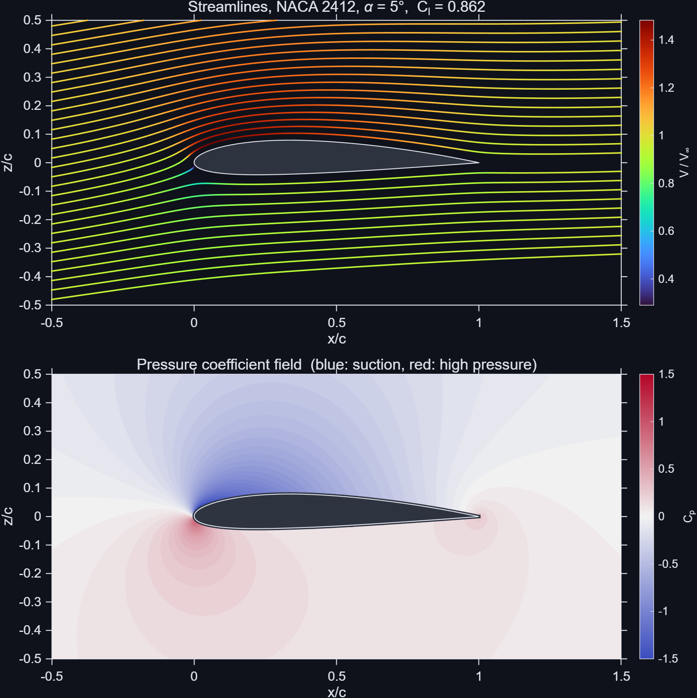
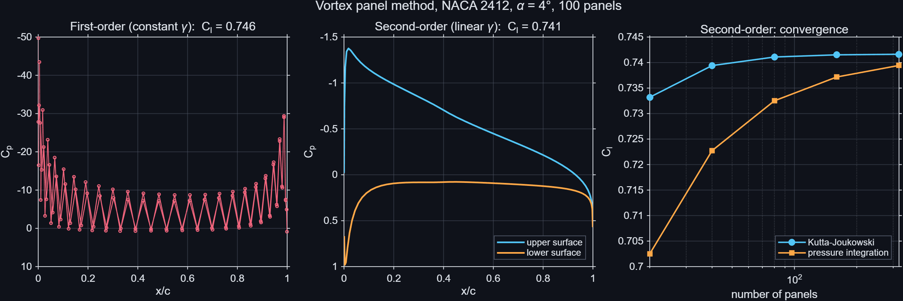
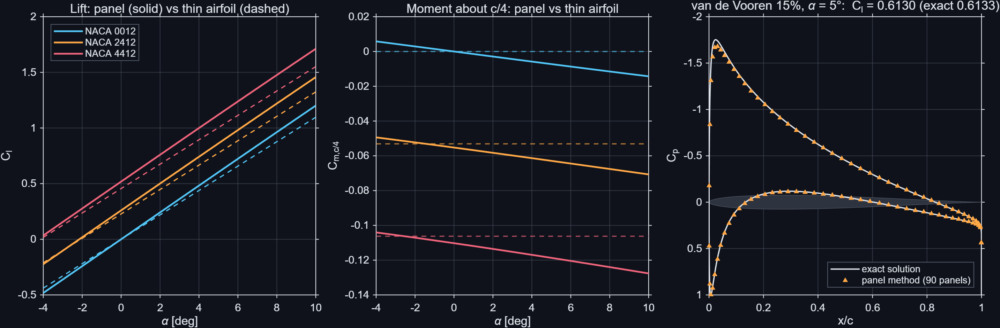
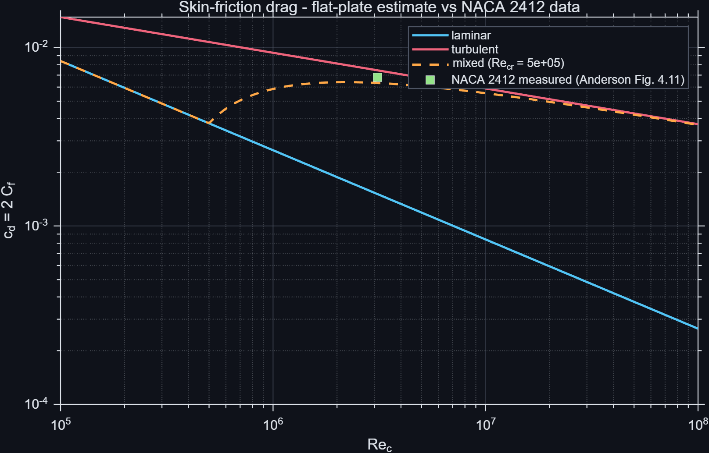
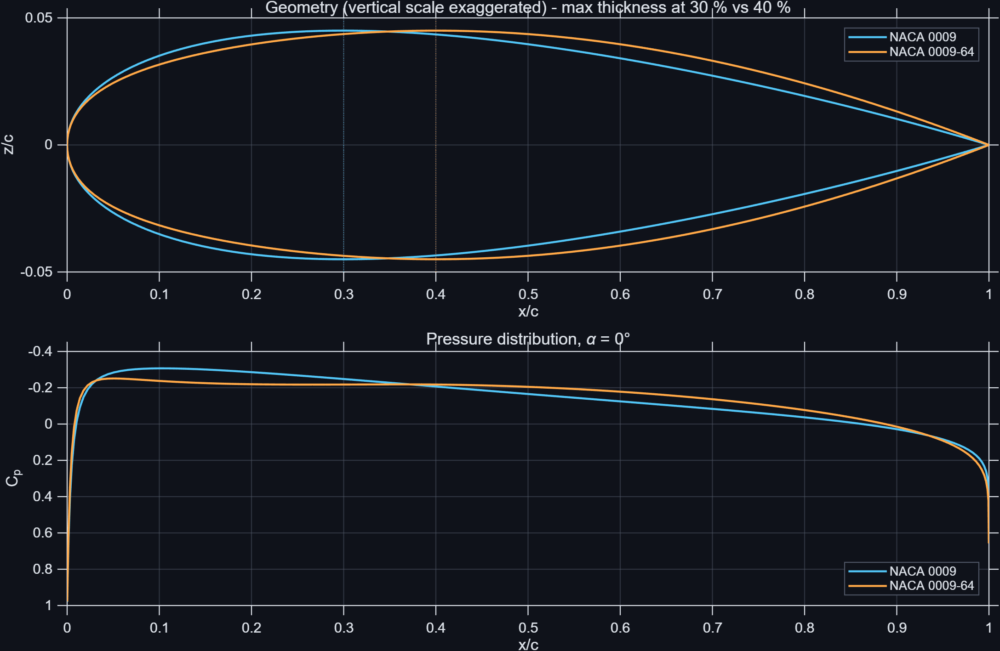
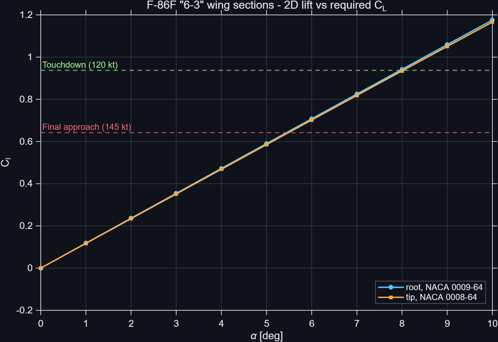

# Vortex Panel Solver

A 2D incompressible airfoil solver written in MATLAB, built step by step from the theory of
Anderson's *Fundamentals of Aerodynamics* (ch. 4) and Katz & Plotkin's *Low-Speed Aerodynamics*.
It goes from thin airfoil theory to a second-order (linear-strength) vortex panel method, is
validated against an exact solution and textbook data, and is finally applied to the wing
sections of the North American F-86F Sabre ("6-3" wing) at landing-approach conditions.



---

## Contents

| Step | Script | What it does |
|---|---|---|
| 0 | `step0_geometry.m` | NACA 4-digit geometry with cosine spacing and clockwise panel numbering |
| 1 | `step1_thinAirfoil.m` | Thin airfoil theory: Cl, Cm, zero-lift angle, centre of pressure |
| 1b | `step1b_discreteVortex.m` | Discrete vortex method and its convergence to thin airfoil theory |
| 2 | `step2_vortexPanel.m` | First-order (constant-strength) vs second-order (linear-strength) vortex panels |
| 3 | `step3_validation.m` | Validation against thin airfoil theory and the exact van de Vooren solution |
| 4 | `step4_flowField.m` | Velocity field, streamlines and pressure field by superposition |
| 5 | `step5_drag.m` | Skin-friction drag estimate (flat plate, laminar / turbulent / transition) |
| 6 | `step6_naca4mod.m` | NACA modified 4-digit sections (0009-64, 0008-64) of the F-86F wing |
| 7 | `step7_f86Approach.m` | F-86F wing sections at final approach and touchdown |

---

## Why a second-order panel method

The first version used **constant-strength** vortex panels (Anderson §4.10). It gives a
reasonable lift coefficient, but the surface vortex strength oscillates from panel to panel and
the pressure distribution shows a strong zig-zag, as Anderson himself notes. The cause is that a
constant-strength panel induces no tangential velocity at its own midpoint, so neighbouring
panels are only weakly coupled.

The **linear-strength** formulation (Katz & Plotkin §10.3.3 and §11.4.2) makes the vortex
strength continuous between panels, with N + 1 unknowns at the nodes and the Kutta condition
γ₁ + γ_{N+1} = 0 as the extra equation. The oscillations disappear.



Lift is computed in two independent ways, from the circulation (Kutta–Joukowski) and by
integrating the surface pressure, and both converge to the same value as the number of panels
increases. The pressure drag tends to zero, as it should for inviscid flow (d'Alembert's paradox).

---

## Validation

| Check | Reference | Result |
|---|---|---|
| Discrete vortex method, NACA 2412 | Thin airfoil theory | Converges to Cl = 0.6664, Cm,c/4 = −0.0531 at α = 4° |
| Lift slope, NACA 0012 / 2412 / 4412 | Thin airfoil theory (2π /rad) | 6.87–6.90 /rad (thickness raises the slope above 2π) |
| van de Vooren airfoil (ε = 0.10, k = 1.97), α = 5° | Exact conformal-mapping solution | Cl = 0.6130 vs 0.6133 (−0.05 %), Cp matches |
| Skin friction, NACA 2412 at Re = 3.1·10⁶ | Anderson Examples 4.8–4.11 | 0.00151 / 0.00745 / 0.00632 / 0.00529 vs 0.0015 / 0.00744 / 0.0063 / 0.00528 |
| NACA modified 4-digit constants and LE radius | NASA TM X-3284 | Constants identical to the report's program; LE radius within 0.3 % |



The flow field is computed by superposition of the panel influences at any point. As a further
check, the velocity inside the airfoil is practically zero (mean speed ≈ 1·10⁻⁴ V∞), as expected
for a vortex sheet that cancels the flow inside the body.



---

## Application: F-86F Sabre "6-3" wing

The F-86F-25/30/35 "6-3" wing (a fixed leading-edge chord extension of 6 in at the root and
3 in at the tip, replacing the slats) uses the sections NACA 0009-64 mod (root) and
NACA 0008.1-64 mod (tip). The exact "mod" leading-edge shape is not documented, so the base
NACA modified 4-digit sections **0009-64** and **0008-64** are generated from their analytical
definition (NASA TM X-3284): leading-edge radius index 6 and maximum thickness at 40 % chord.

Compared with a standard NACA 0009, the 0009-64 has the same leading-edge radius but its
maximum thickness further aft. At zero lift this lowers the suction peak (Cp,min ≈ −0.25 vs
−0.31) and spreads it along the chord, which delays the point where the flow first becomes
sonic, a desirable property for a transonic fighter.



At landing-approach conditions (T.O. 1F-86F-1, Fig. 2-6: 13,800 lb, no slats) the whole
pattern is at M < 0.26, so the incompressible model is applicable:

| | Final approach (145 kt) | Touchdown (120 kt) |
|---|---|---|
| Mach number | 0.219 | 0.181 |
| Required C_L = W/(qS) | 0.642 | 0.937 |
| Re, root / tip | 1.68·10⁷ / 8.55·10⁶ | 1.39·10⁷ / 7.07·10⁶ |
| Friction cd, root / tip | 0.0051 / 0.0057 | 0.0053 / 0.0058 |
| Equivalent 2D angle of attack | 5.5° | 8.0° |



Wing area (302 ft²) is taken from NACA RM A56G30; root and tip chords (10.77 ft and 5.49 ft)
are derived from its planform data plus the 6-3 chord extension.

---

## Limitations

- **Inviscid and incompressible:** valid for attached flow and Mach numbers below about 0.3.
  No stall, no boundary-layer displacement effect.
- **Two-dimensional:** no sweep, no finite-span or induced-drag effects.
- **Drag** is a flat-plate skin-friction estimate; it does not include pressure drag from
  separation, and it depends on the assumed transition Reynolds number (5·10⁵).
- **F-86F case:** the real aircraft lands with flaps down and a 35° swept wing, and C_L = W/(qS)
  is a whole-aircraft value, so the 2D angle of attack is illustrative only. The undocumented
  "mod" leading-edge shape is not modelled.

---

## How to run

Requires MATLAB R2020a or newer (developed on R2025b). No toolboxes needed.

1. Download the repository (**Code → Download ZIP**) or clone it.
2. Open MATLAB in the `vortex-panel-solver` folder.
3. Run any step, for example:

```matlab
run('examples/step2_vortexPanel.m')
```

Each script adds `src/` to the path, prints its results to the Command Window and saves its
figure to `figures/`.

### Main functions

| Function | Purpose |
|---|---|
| `naca4`, `naca4mod` | Airfoil coordinates (NACA 4-digit and modified 4-digit) |
| `vanDeVooren` | Exact geometry and pressure distribution of the van de Vooren airfoil |
| `thinAirfoil`, `discreteVortex` | Thin airfoil theory and discrete vortex method |
| `panelGeometry` | Panel end points, midpoints, lengths, tangents and normals |
| `vortexPanelConstant`, `vortexPanel` | First- and second-order vortex panel solvers |
| `flowField` | Velocity at arbitrary points by superposition |
| `skinFriction` | Flat-plate skin-friction drag coefficient |

All coordinates are non-dimensional (chord c = 1, V∞ = 1).

---

## References

- Anderson, J. D., *Fundamentals of Aerodynamics*, 6th ed., McGraw-Hill, 2017. Chapter 4
  (thin airfoil theory, vortex panel method, skin friction, Examples 4.8–4.11).
- Katz, J. and Plotkin, A., *Low-Speed Aerodynamics*, 2nd ed., Cambridge University Press, 2001.
  §3.9, §6.6–6.7, §10.3.3, §11.4.2.
- van de Vooren, A. I. and de Jong, W., Report TW-86, University of Groningen, 1969, as presented
  in Katz & Plotkin §6.7.
- Ladson, C. L. and Brooks, C. W., Jr., *Development of a Computer Program to Obtain Ordinates
  for NACA 4-Digit, 4-Digit Modified, 5-Digit, and 16-Series Airfoils*, NASA TM X-3284, 1975.
- Anderson, S. B., Quigley, H. C. and Innis, R. C., *Flight Measurements of the Low-Speed
  Characteristics of a 35° Swept-Wing Airplane with Blowing-Type Boundary-Layer Control on the
  Trailing-Edge Flaps*, NACA RM A56G30, 1956.
- *Flight Handbook, USAF Series F-86F Aircraft*, T.O. 1F-86F-1, Section II, Fig. 2-6 (p. 2-17).
- Lednicer, D., *The Incomplete Guide to Airfoil Usage*, UIUC Applied Aerodynamics Group.

---

## Author

Álvaro San Román Benítez, Aerospace Engineering student.

Released under the [MIT License](LICENSE).
